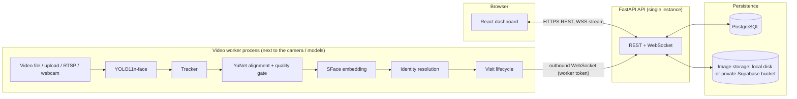
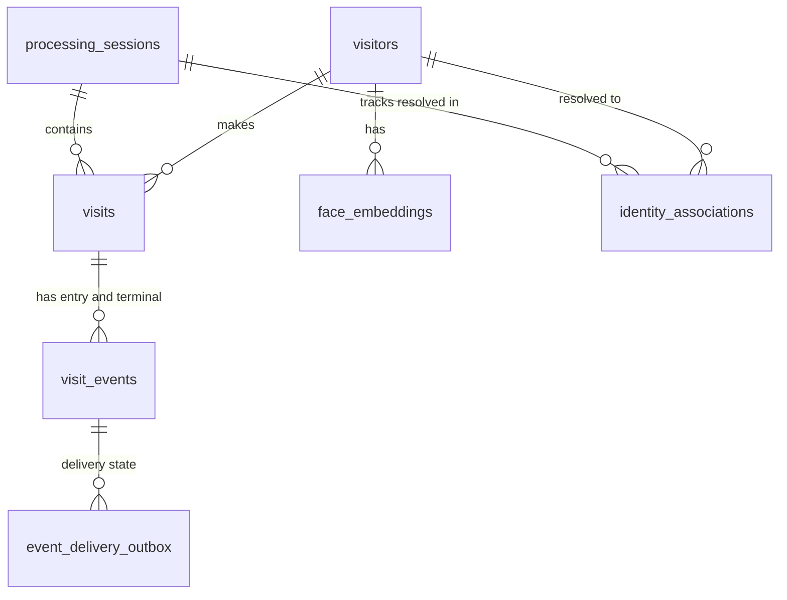
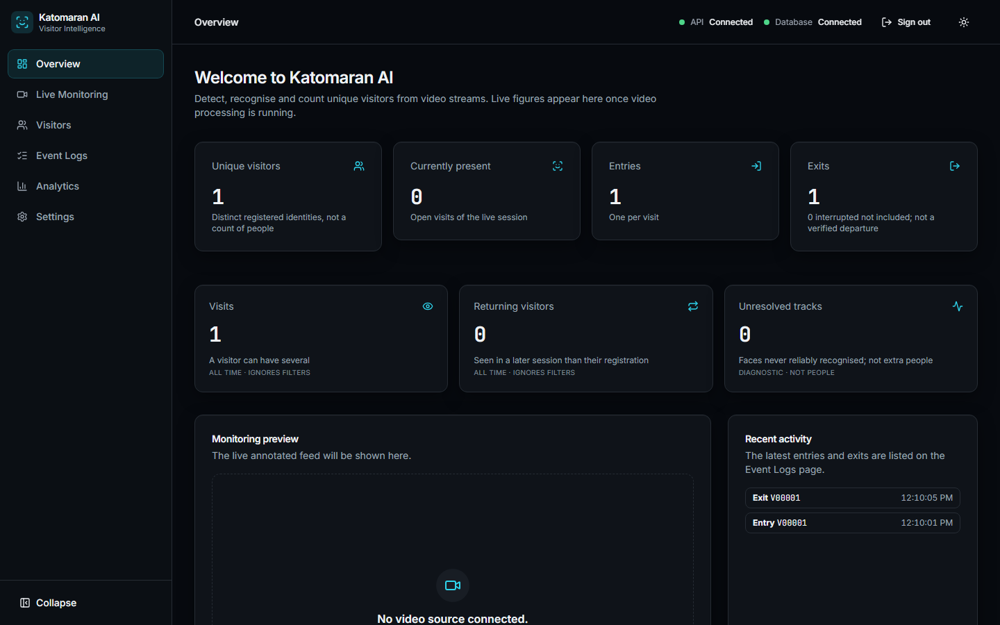
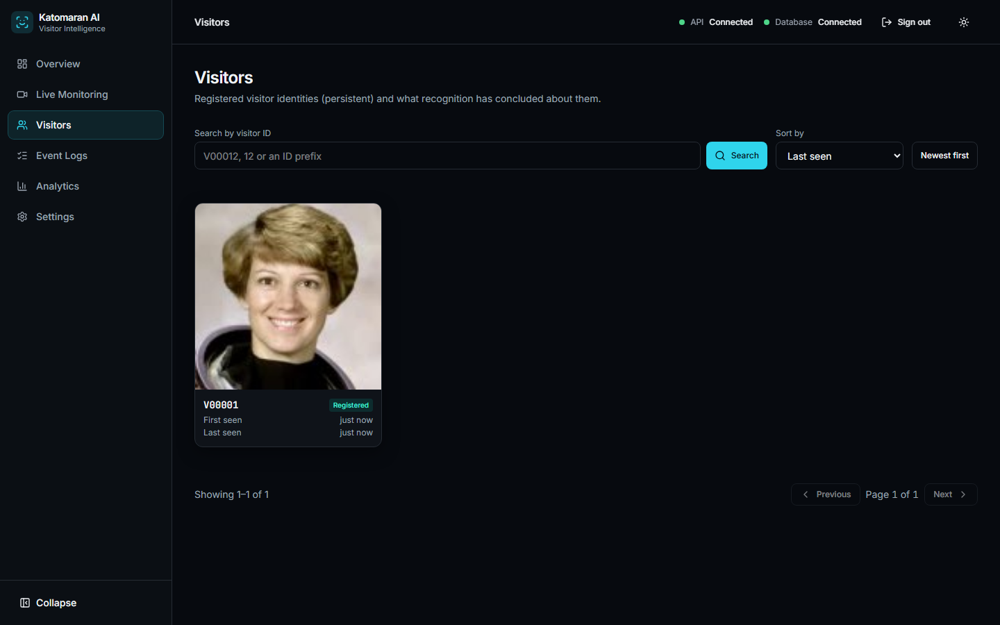

# Katomaran AI — Intelligent Face Tracker & Visitor Analytics

**Detects, tracks and recognises faces in video files, RTSP streams and a local webcam, registers new faces automatically, logs one entry and one exit per visit with timestamped face evidence, and reports unique-visitor analytics from the database.**

> **Unique visitor metrics count registered face identities, not verified physical people.** Faces that fail the recognition quality gate are never identified or counted, and no person-level ground truth exists for the hackathon footage.

     

## 🎥 Watch the Demonstration

[Watch the Complete Katomaran Face Tracker Demonstration](https://www.loom.com/share/0820e258870e4076934da68bf7a79c00)

The recording plan that was followed is in [docs/submission/demo-video-script.md](docs/submission/demo-video-script.md).

| Deliverable | Status |
|---|---|
| Demo video (Loom) | [Watch on Loom](https://www.loom.com/share/0820e258870e4076934da68bf7a79c00) (shared publicly; checked by the project owner) |
| GitHub repository | https://github.com/Nandana-T/Face-Tracker |
| Live deployed frontend / API | **Not deployed.** Configuration is prepared ([Deployment](#deployment)) |
| Sample outputs | [docs/sample-output/](docs/sample-output/) (public-domain fixture only) |

## At a glance

| Area | What it does |
|---|---|
| **Computer vision** | YOLO11n-face detection (ONNX Runtime, CPU), configurable frame skipping, ByteTrack-style multi-face tracking, YuNet landmark alignment, SFace embeddings |
| **Visitor intelligence** | Automatic registration of new faces, re-identification across sessions and restarts, visit lifecycle with exactly one entry and one terminal event per visit |
| **Evidence** | Timestamped cropped-face images on the local filesystem, PostgreSQL metadata, mandatory `events.log` |
| **Analytics** | Unique registered identities via `COUNT(DISTINCT ...)`, returning visitors, entries, exits, active visits, read-only reconciliation |
| **Dashboard** | Live annotated video, visitor gallery, event timeline, analytics (React) |
| **Sources** | Video file, **upload a video from the dashboard**, RTSP stream, **this computer's webcam** |

**Quick start (Windows, PowerShell):** see [Installation and local setup](#installation-and-local-setup). In short: `.\scripts\install.ps1`, `.\scripts\migrate.ps1`, `.\scripts\start-all.ps1`, then `.\scripts\start-frontend.ps1` in a second terminal.

## Contents
[Overview](#project-overview) · [Features](#key-features) · [Architecture](#architecture) · [AI pipeline](#the-ai-pipeline) · [Stack](#technology-stack) · [Structure](#project-structure) · [Setup](#installation-and-local-setup) · [Configuration](#configuration) · [Running](#running-the-application) · [Data model](#database-and-data-model) · [Logging](#logging-and-evidence) · [Counting](#unique-visitor-counting) · [Sample output](#sample-outputs) · [Testing](#testing-and-quality-assurance) · [Benchmarks](#benchmarks-and-compute-requirements) · [Deployment](#deployment) · [Security](#security-and-privacy) · [Limitations](#known-limitations) · [AI workflow](#ai-assisted-development-workflow) · [Troubleshooting](#troubleshooting) · [Docs index](#documentation-index)

## Project overview

**Problem.** A site wants to know how many *different* visitors appear on camera, and when each one arrived and left. Counting detections or tracks over-counts badly: one person leaves the frame and returns, is occluded, or appears in several videos, and each appearance would be counted again.

**Detecting is not identifying.** A detector only says "there is a face in this box". A tracker links boxes across frames for a short time. Neither knows that the person in the lobby at 10:00 is the person at the door at 14:00. That requires a face *embedding* compared against stored identities.

**What automatic registration achieves.** When a face is good enough and matches nobody, the system registers it as a new visitor (`V00124`). The next time that face is recognised it resolves to the same identity, so repeated visits do not raise the number of distinct identities.

**What the application produces**
- Persistent visitor identities with stored embeddings and a face image.
- A visit per presence episode, with one entry and one terminal (exit) event, each with a timestamped crop.
- `events.log`, database records and unique-visitor analytics.

## Key features

Every item below exists in the codebase and is covered by tests or a report.

**Computer vision**
- YOLO11n-face detection, `detection.frame_skip` set in `config.json`
- Multi-face tracking with a TENTATIVE, CONFIRMED, LOST, REMOVED lifecycle
- SFace recognition with YuNet landmarks and alignment
- Automatic registration with a quality gate and a consistency check
- Recognition quality filtering (size, sharpness, pose, confidence)

**Visitor intelligence**
- Persistent visitor ids, registration de-duplication
- Visit lifecycle with grace period and reacquisition
- Idempotent entry and terminal events
- Unique identity counting, returning-visitor metrics

**Monitoring dashboard**
- Live video with bounding-box overlays and track/recognition labels
- Visitor gallery and details, Event Logs with evidence images
- Analytics and Overview pages, live refresh
- Video upload and deletion, source selection (file, RTSP, webcam)

**Reliability and security**
- Sign-in, protected REST routes, single-use WebSocket tickets, worker token
- Outbox delivery with exactly-once logical events (unique constraints and deterministic ids)
- Private image storage, crash reconciliation, structured logs
- Automated unit, integration, component and end-to-end tests

## Architecture



| Component | Role |
|---|---|
| **Frontend** | React SPA. Signs in, starts and stops sessions, shows the live stream, visitors, events and analytics. Never receives embeddings. |
| **API** | FastAPI (`/api/v1`). Owns the live session state, all database and image writes, and serves the dashboard. Loads no AI model. |
| **Video worker** | Separate Python process. Reads the source, runs detection, tracking and recognition, and **dials the API over an outbound WebSocket**. It holds no database credentials and opens no inbound port. |
| **Database** | PostgreSQL (source of truth). Schema created only by Alembic. |
| **Image storage** | Face crops and evidence images, switchable between local disk and a private Supabase Storage bucket (`STORAGE_BACKEND`). Never served statically. |
| **WebSocket** | Worker to API (events, frames), API to browser (annotated frames and change notices, using single-use tickets). |

Design rationale: [docs/architecture.md](docs/architecture.md), [ADR 0001](docs/decisions/0001-modular-monolith-with-worker.md), [ADR 0008](docs/decisions/0008-worker-api-transport.md).

## The AI pipeline

| # | Stage | Detail |
|---|---|---|
| 1 | **Frame acquisition** | File, uploaded file, RTSP (timeouts, bounded reconnect with back-off, stall watchdog, credentials redacted in logs) or local webcam |
| 2 | **YOLO face detection** | `yolov11n-face` ONNX, 640 px input, confidence 0.5, NMS IoU 0.45 |
| 3 | **Frame skipping** | `detection.frame_skip = N` skips N frames between detections, so the detector runs on every (N+1)th frame. Default 2 means every third frame |
| 4 | **Multi-face tracking** | ByteTrack-style, time-based (seconds, not frames) so it does not depend on FPS or frame skip |
| 5 | **Crop generation** | Face crop (max 192 px) per confirmed track |
| 6 | **Landmarks and alignment** | YuNet 5-point landmarks, similarity alignment |
| 7 | **Quality assessment** | Size, detector confidence, yaw/roll, sharpness, combined score. A failing face is never identified or registered |
| 8 | **Embedding** | SFace, 128-dimensional, scheduled per track (not every face on every frame) |
| 9 | **Identity matching** | Cosine similarity with a vote window, an ambiguity margin and switch hysteresis |
| 10 | **Automatic registration** | Needs consecutive novel observations over time, mean quality and mutual consistency |
| 11 | **Visit lifecycle** | Video-time rules for missing, reacquired and closed visits |
| 12 | **Evidence persistence** | Image, then one database transaction (visit, event, outbox), then an `events.log` line |
| 13 | **Unique-visitor analytics** | SQL aggregates over visits and identities |

**Three different identifiers**

| Id | Scope | Meaning |
|---|---|---|
| `track_id` | One session, temporary | A box followed across frames. Never reused, never stored as identity |
| `visitor_id` | Permanent | A registered face identity (shown as `V00124`) |
| `visit_id` | One presence episode | One continuous (or briefly interrupted) stay of one visitor |

**Example.** Visitor `V00007` is registered at 10:00 (track 4, visit A). They leave, return at 11:30 in a new session (track 2, visit B). Visits become 2 and entries become 2, but unique registered identities stay at 1, because the count is `COUNT(DISTINCT visitor_id)`.

## Technology stack

Versions are taken from `backend/pyproject.toml`, `backend/uv.lock` and `frontend/package.json`.

| Layer | Technology |
|---|---|
| Frontend | React 19, TypeScript 6, Vite 8, React Router 7, TanStack Query 5, Tailwind CSS 4 |
| Backend | Python 3.12, FastAPI, Uvicorn, Pydantic 2, SQLAlchemy 2 (sync), psycopg 3, Alembic |
| Detection | YOLO11n-face, ONNX Runtime (CPU provider) |
| Tracking | In-repo ByteTrack-style tracker ([ADR 0012](docs/decisions/0012-tracker-selection.md)) |
| Recognition | SFace 128-d embeddings ([ADR 0013](docs/decisions/0013-recognition-model-and-licensing.md)) |
| Landmarks / alignment | YuNet |
| Video I/O | OpenCV (headless) |
| Database | PostgreSQL 15+ (embedded `pgserver` locally, Supabase when hosted) |
| Image storage | Local filesystem (default), Supabase private bucket (implemented, not yet exercised against a real bucket) |
| Real-time transport | WebSocket (worker to API, API to browser) |
| Testing | pytest, Vitest, Testing Library, Playwright |
| Quality | Ruff, mypy (strict), ESLint, `tsc` |
| Deployment config | Vercel (frontend), Render (`render.yaml`, API), Supabase (database and storage) |

**Deployed vs configured.** Only the Supabase **database** has been touched: migrations to `0004` were applied and verified ([docs/gate-a-runbook.md](docs/gate-a-runbook.md)). Vercel, Render and the Supabase storage bucket are configured but **not provisioned**.

## Project structure

```text
Face-Tracker/
├── backend/
│   ├── app/
│   │   ├── api/v1/          REST + WebSocket routes (auth, processing, visitors, events, analytics, uploads, ws)
│   │   ├── core/            config schema, settings, errors, logging
│   │   ├── db/ models/ repositories/ schemas/
│   │   ├── services/        identity, visits, events, analytics, session manager, storage
│   │   ├── vision/          detection/, tracking/, recognition/, sources/ (file, rtsp, webcam)
│   │   └── workers/         video worker process, pipeline, protocol
│   ├── alembic/versions/    migrations 0001-0004
│   ├── benchmarks/          measured benchmarks and evaluations
│   └── tests/               unit, integration, e2e
├── frontend/
│   ├── src/features/        monitoring, visitors, events, analytics, overview, auth, settings
│   └── e2e/                 Playwright suites
├── config/config.json       validated runtime configuration
├── scripts/                 install, migrate, start, check, verification tools
├── docs/                    architecture, reports, ADRs, benchmarks, sample output, submission
├── render.yaml              Render blueprint (not applied)
└── docker-compose.yml       optional local PostgreSQL
```

Model weights, datasets, caches, logs with real faces, backups and `.env` are git-ignored and never committed.

## Installation and local setup

**Requirements:** Windows 11 with PowerShell, Git, Node.js 20+, [uv](https://docs.astral.sh/uv/) (installs Python 3.12 into the project), PostgreSQL 15+ (hosted, or the embedded one started by `scripts\local-db.ps1`, no Docker needed), and Microsoft Edge or Chrome for the E2E tests. Docker is optional. Linux works with equivalent commands but is not the primary tested environment.

```powershell
git clone https://github.com/Nandana-T/Face-Tracker.git D:\Face-Tracker
cd D:\Face-Tracker

.\scripts\install.ps1                        # Python 3.12 venv, npm ci, creates .env from .env.example
# edit .env: DATABASE_URL (or use the local database below), WORKER_TOKEN

. .\scripts\local-db.ps1 start               # optional: embedded PostgreSQL in storage\pgdata, sets DATABASE_URL
.\scripts\download-model.ps1                 # YOLO face model, checksum-verified (explicit, never automatic)
.\scripts\download-model.ps1 -Recognition    # SFace + YuNet (read ADR 0013 first: non-commercial scope)
.\scripts\migrate.ps1                        # Alembic migrations 0001-0004
.\scripts\make-sample-video.ps1              # optional synthetic demo clip
```

The venv, caches, models, datasets and logs all stay inside the project directory ([docs/deployment.md](docs/deployment.md)). Run `. .\scripts\env.ps1` first if you invoke tools by hand.

**Starting the servers (two terminals, because both block):**

```powershell
# Terminal 1: API (127.0.0.1:8000, docs at /api/docs) and the video worker as two processes
.\scripts\start-all.ps1

# Terminal 2: dashboard at http://localhost:5173
.\scripts\start-frontend.ps1
```

`scripts\start-backend.ps1` and `scripts\start-worker.ps1` start the API and worker separately. Docker is not required.

## Configuration

**Environment (`.env`, see `.env.example`; never commit it).**

| Component | Variables |
|---|---|
| API | `APP_ENV`, `CORS_ORIGINS`, `CONFIG_FILE`, `LOG_DIR`, `STORAGE_DIR`, `MODELS_DIR`, `LOG_LEVEL` |
| Database | `DATABASE_URL`, `DB_POOL_SIZE`, `DB_MAX_OVERFLOW`, `DB_CONNECT_TIMEOUT_SECONDS`, `DB_CONNECT_RETRIES`, `DB_USE_PGBOUNCER`, `TEST_DATABASE_URL` (tests only) |
| Authentication | `ADMIN_PASSWORD`, `AUTH_SECRET`, `AUTH_TOKEN_TTL_MINUTES` |
| Worker | `WORKER_TOKEN`, `WORKER_API_URL`, `WORKER_ID` |
| Storage | `STORAGE_BACKEND` (`local` or `supabase`), `SUPABASE_URL`, `SUPABASE_SERVICE_ROLE_KEY`, `SUPABASE_BUCKET` (API only) |
| Video sources | `RTSP_*` variables, referenced by name from `config.json` |
| Frontend (build time) | `VITE_API_BASE_URL`, `VITE_DEV_PROXY_TARGET` |

`APP_ENV=production` requires `ADMIN_PASSWORD`, `AUTH_SECRET`, a 24+ character `WORKER_TOKEN` and https-only `CORS_ORIGINS`. Generate a token with `python -c "import secrets; print(secrets.token_urlsafe(32))"`.

**Sample `config/config.json`** (abridged from the validated file; the schema rejects unknown keys, and changes need an API and worker restart):

```json
{
  "video": {
    "sample_dir": "datasets/samples",
    "webcam_enabled": true,
    "webcam_index": 0,
    "sources": [
      { "id": "lobby-file", "label": "Lobby recording", "type": "file", "path": "datasets/samples/lobby.mp4" },
      { "id": "front-door", "label": "Front door camera", "type": "rtsp", "url_env": "RTSP_FRONT_DOOR" }
    ],
    "rtsp": { "connect_timeout_seconds": 10, "read_timeout_seconds": 10, "max_reconnect_attempts": 0, "max_backoff_seconds": 30 }
  },
  "detection": { "frame_skip": 2, "confidence_threshold": 0.5, "model": "yolov11n-face", "input_size": 640, "iou_threshold": 0.45, "max_faces": 100, "intra_op_threads": 4, "cpu_spin_wait": false },
  "worker": { "queue_size": 4, "realtime_pacing": true, "heartbeat_interval_seconds": 5 },
  "stream": { "max_fps": 15, "max_width": 960, "jpeg_quality": 70 },
  "recognition": { "similarity_threshold": 0.50, "novelty_threshold": 0.40 },
  "tracking": { "enabled": true, "high_confidence": 0.6, "confirm_hits": 3, "max_missing_seconds": 2 },
  "visits": { "missing_after_seconds": 1.5, "exit_after_seconds": 8, "max_frame_gap_seconds": 2, "evidence_dir": "logs" },
  "logging": { "level": "INFO", "events_file": "logs/events.log" }
}
```

**`frame_skip` semantics.** It is the number of frames *skipped between detections*. With `frame_skip = 2` the detector runs on frames 0, 3, 6, and so on. The tracker is updated only on analysed frames, using their real timestamps, and its timeouts are in seconds, so they do not depend on the frame rate. Values above about 3 are not recommended in crowds.

**RTSP.** Put the URL (which may contain credentials) in an environment variable such as `RTSP_FRONT_DOOR` and reference only its *name* via `url_env`. The browser can only choose a source id, never a path or URL.

The full key reference (every threshold, with its meaning) is in [docs/architecture.md](docs/architecture.md) and the phase reports ([tracking](docs/phase-2-report.md), [recognition](docs/phase-3-report.md), [visits](docs/phase-4-report.md)).

## Running the application

1. **Database.** Use your hosted `DATABASE_URL`, or `. .\scripts\local-db.ps1 start`, then `.\scripts\migrate.ps1`.
2. **API and worker.** `.\scripts\start-all.ps1`.
3. **Frontend.** `.\scripts\start-frontend.ps1`, then open http://localhost:5173.
4. **Sign in** with `ADMIN_PASSWORD` if it is set (without it, local development stays open).
5. **Select a source** on **Live Monitoring**: a sample, an RTSP camera, **This computer's camera**, or **Upload a video** (Choose file; mp4, avi, mkv, mov, webm).
6. **Start processing.** Start is disabled with an explanation if no worker is connected or a model is missing.
7. **Observe** the live stream: boxes, `#id` track labels, recognition labels (`V...`, "Recognizing", "Low quality").
8. **Visitors** page: registered visitors, gallery and details.
9. **Event Logs** page: entry and exit events with their crops, visit details.
10. **Analytics** and **Overview** pages: unique registered identities, returning visitors, visits, events, coverage diagnostics.
11. **Stop** the session with the Stop button. Leaving the page does not stop it.

Uploaded videos are stored on the API host under `storage/uploads`; the worker must read the same folder (true locally). You can delete an upload afterwards. Only upload videos you are allowed to process: faces in them are processed and visitors are registered.

## Database and data model

Created only by Alembic migrations `0001`-`0004` ([backend/alembic/versions/](backend/alembic/versions/)).



| Table | Role |
|---|---|
| `app_metadata` | Schema bookkeeping (migration 0001) |
| `processing_sessions` | One row per processing run: source, state, timestamps. At most one active (migration 0002) |
| `visitors` | Persistent registered identities (`visitor_id`, `V...` label) (0003) |
| `face_embeddings` | Up to 5 embeddings per visitor, never exposed by the API (0003) |
| `identity_associations` | Records which session track resolved to which visitor (0003) |
| `visits` | One presence episode per visitor with entry time, end time and closure reason (0004) |
| `visit_events` | `entry` and terminal events with evidence image reference. Unique constraints and deterministic ids make logical events exactly-once (0004) |
| `event_delivery_outbox` | Tracks delivery of each event to `events.log` and retries (0004) |

Migrate with `.\scripts\migrate.ps1` (local) or `.\scripts\migrate-cloud.ps1` (hosted, only after reading [docs/gate-a-runbook.md](docs/gate-a-runbook.md); it backs up and rehearses a restore first). Never put credentials in the command or the repository.

## Logging and evidence

- **`events.log`** (`logging.events_file`, JSON lines): the pipeline narrative plus durable `visit.entry`, `visit.exit` and `visit.interrupted` records with event id, visit id, visitor id, time, source, image reference, persistence outcome and delivery attempt.
- **Evidence images**: `logs/entries/YYYY-MM-DD/<event_id>.jpg` and `logs/exits/YYYY-MM-DD/<event_id>.jpg`, local filesystem, never served statically.
- **Event kinds**: entry; exit (visitor absent past `exit_after_seconds`, recorded at the last sighting); *observation ended* (video ended or monitoring stopped while the visitor was in view); *interrupted* (worker, API or source failed, so the end is unknown).
- **Exit evidence is the last good crop**, not an image captured at the physical instant of departure (`image_kind: last_good_observation`).
- **Idempotency**: deterministic event ids and unique constraints prevent duplicate logical events; the log's `delivery_attempt` explains a redelivery after a crash.
- **Verification**: `python scripts\verify_events_log.py` compares the file with the database (missing lines, unexplained duplicates, unknown events). Also `GET /api/v1/events/log-verification`.

## Unique visitor counting

| Metric | Definition |
|---|---|
| **Registered identities** | All visitors in the database (global) |
| **Unique registered identities (scope)** | `COUNT(DISTINCT visitor_id)` over visits whose entry time falls in a date or session scope `[since, until)` |
| **Returning visitors** | Seen in a later session than the one that registered them |
| **Visits** | Presence episodes (never a count of people) |
| **Entries / terminal events** | Event rows by type |
| **Active observed visits** | Open visits of the *live* session; stale rows from crashed sessions are reported, not counted |
| **Unresolved diagnostics** | Tracks that never reached an identity (recognition coverage) |

Repeated tracks, visits or retries never increase the global identity count by themselves. Faces that are ambiguous or unresolved are never added to a unique count. Erasing an identity removes it from the registered count. `python scripts\reconcile_counts.py` recomputes the counts independently (**read-only**; there is no repair mode). Definitions and semantics: [docs/phase-5-report.md](docs/phase-5-report.md), [ADR 0015](docs/decisions/0015-counting-semantics.md).

## Sample outputs

All files below are **real output of the running application**, produced from the public-domain NASA portrait test fixture and an embedded local PostgreSQL database. They contain no real visitor, no hackathon footage, no credentials and no embeddings.

**Dashboard screenshots** (captured from the real stack with Playwright, `frontend/e2e/capture-evidence.spec.ts`)

| Screenshot | Shows |
|---|---|
| [Overview](docs/sample-output/screenshots/overview-dashboard.png) | Unique visitors 1, entries 1, exits 1, recent activity |
| [Visitor gallery](docs/sample-output/screenshots/visitor-gallery.png) | Registered identity `V00001` with its face image |
| [Analytics](docs/sample-output/screenshots/analytics.png) | Scoped counts computed from the database |




**Records from the same run** (exported from the API responses, which never contain embeddings or server paths)

| Sample | File |
|---|---|
| Visitor record | [visitor-records.json](docs/sample-output/visitor-records.json) |
| Visit record | [visit-records.json](docs/sample-output/visit-records.json) |
| Event records (entry and exit) | [event-records.json](docs/sample-output/event-records.json) |
| Analytics response | [analytics-dashboard-overview.json](docs/sample-output/analytics-dashboard-overview.json) |
| Matching `events.log` lines | [events-log-dashboard-run.jsonl](docs/sample-output/events-log-dashboard-run.jsonl) (each database event has exactly one record) |

**Earlier run (local RTSP server source):** [analytics](docs/sample-output/analytics-overview.json), [visits and events](docs/sample-output/visits-and-events.json), [events.log excerpt](docs/sample-output/events-log-excerpt.jsonl), [reconciliation](docs/sample-output/reconciliation.json), [entry image](docs/sample-output/images/entry-ad5187e3.jpg), [exit image](docs/sample-output/images/exit-d3331967.jpg).

Evidence from the **real hackathon footage** is private and git-ignored (it shows real people); only aggregate numbers are published in [docs/final-evaluation.md](docs/final-evaluation.md) and [docs/real-video-validation.md](docs/real-video-validation.md). The dashboard screenshots do not include a live-video detection overlay; that appears only during a running session.

## Testing and quality assurance

| Layer | Tools | What it covers |
|---|---|---|
| Backend unit and integration | pytest (embedded PostgreSQL) | domain logic, API, database constraints, event delivery, analytics |
| Frontend components | Vitest, Testing Library | pages, upload, monitoring states |
| End to end | Playwright | the real stack with real models, restarts, crash recovery, analytics workflow |
| Static checks | Ruff, mypy strict, ESLint, `tsc`, production build | |
| Data checks | `scripts\verify_events_log.py`, `scripts\reconcile_counts.py` | log vs database, count consistency |

```powershell
.\scripts\check.ps1              # everything (uses the local PostgreSQL)
.\scripts\check.ps1 -SkipE2E
.\scripts\test-backend.ps1       # add -Unit for unit tests only
.\scripts\test-frontend.ps1      # add -E2E for Playwright
```

**Latest results actually run on this machine:**

| Suite | Result | Date |
|---|---|---|
| Backend pytest | **598 passed** | 2026-11-12 |
| Frontend Vitest | **255 passed** (18 files, `--maxWorkers=2`) | 2026-11-12 |
| Playwright, full suite | **30 passed** (before the upload and webcam features) | 2026-11-11 |
| Playwright, new video-upload test | **1 passed**, run on its own | 2026-11-12 |
| Ruff, mypy strict, ESLint, `tsc`, build | clean | 2026-11-12 |

The full Playwright suite was **not re-run** after the upload and webcam changes, and there is no browser test for the webcam source. The webcam source was checked against the real device and with unit tests using fake captures. Local verification scripts: `scripts\verify_remote_path.py` (production mode, TLS, remote-style worker), `scripts\verify_rtsp_local.py` (local RTSP server). Breakdown and gaps: [docs/testing-strategy.md](docs/testing-strategy.md).

**Known limitation:** some Starlette `TestClient` WebSocket tests are intermittently flaky (present on a clean HEAD as well). Machine memory pressure can also crash test workers on this 16 GB laptop; use `OPENBLAS_NUM_THREADS=2` and `--maxWorkers=2`.

## Benchmarks and compute requirements

Measured on **Intel Core i5-1240P (12 cores / 16 threads), 15.7 GB RAM, Intel Iris Xe integrated graphics, CPU only**. Source reports: [phase1](docs/benchmarks/phase1-benchmark.md), [phase3](docs/benchmarks/phase3-recognition.md), [phase4](docs/benchmarks/phase4-visits.md), [phase5](docs/benchmarks/phase5-analytics.md), [real footage](docs/final-evaluation.md). The figures come from different scenarios and are not directly comparable.

| Measurement | Value | Scenario |
|---|---|---|
| YOLO inference (real footage) | ≈ 55 ms per analysed frame (78 ms for 4K) | hackathon clips, 4 threads, `frame_skip=2` |
| Detector throughput | ≈ 14.3 analysed frames/s (≈ 23 frames/s consumed at `frame_skip=0`) | detector benchmark ([phase1](docs/benchmarks/phase1-benchmark.md)), different scenario |
| Worker memory | 520 MB typical on hall footage; 881 MB on 4K | peak RSS on real footage |
| Recognition overhead | 10-16 ms per face (p95 31-38 ms), ≈ 2 ms/frame detector cost | [phase3](docs/benchmarks/phase3-recognition.md) |
| Event persistence | 14-18 ms per event, off the frame path | [phase4](docs/benchmarks/phase4-visits.md) |
| CPU use | ≈ 24 % of 16 threads at `frame_skip=2` on real footage; 4K runs about real time with no headroom | |
| API memory | ≈ 115 MB, never loads a model | local production-mode run |
| Worker memory (remote-style run) | 171-181 MB idle to active | local TLS loopback, not a network |
| Model load / session init | ≈ 85 ms to create the ONNX session | phase1 benchmark |
| Worker to browser latency | ≈ 6.6 ms mean | loopback on the same host, **not network latency** |

**GPU: nothing was measured.** There is no usable GPU on the test machine and the detector pins the CPU execution provider. The report records an *unverified* hypothesis only: a discrete NVIDIA GPU is likely much faster per inference, but that needs a small untested code change (CUDA or DirectML provider) and measurement on the target GPU. Concurrent streams were not measured. Practical sizing: one stream per worker with 4 CPU threads and 1 GB RAM is what was verified.

## Deployment

| Item | Status |
|---|---|
| Supabase PostgreSQL | **Cloud verified:** migrations applied to `0004` and verified ([gate runbook](docs/gate-a-runbook.md)) |
| Supabase private Storage bucket | Implemented and tested against a fake backend. **Not created or verified in the cloud** |
| Render API (`render.yaml`) | **Configured only.** Never built or deployed (Docker is not installed on the development machine) |
| Vercel frontend | **Configured only, not deployed** |
| Worker connecting over WSS | Verified **locally** with production mode, TLS and a remote-style worker (`scripts\verify_remote_path.py`) |

**No production URL exists.** Nothing is live. The architecture is: Vercel (static SPA) calls one Render FastAPI instance over HTTPS/WSS; the API uses Supabase PostgreSQL and a private Supabase bucket (service-role key on the API only); the AI worker runs on your own machine and connects outbound to `wss://.../api/v1/worker/ws` with the worker token. Keep the API at **one instance** because live session state is in memory. Environment variables, free-tier limits (15-minute spin-down), recovery and rollback: [docs/deployment-guide.md](docs/deployment-guide.md). Limitations: uploads and the webcam need the worker on the same machine as the files or camera, and the dashboard needs a worker running somewhere to process video.

## Security and privacy

- **Authentication:** shared admin password to a signed token; every REST route except `/health`, `/ready` and `/auth/*` is protected; login throttling.
- **WebSocket:** single-use tickets bound to the session or to the analytics channel; the worker authenticates with a token.
- **Biometric data:** embeddings and face images are never returned to the frontend, never served statically, and stay in private storage. Erasing a visitor deletes their data.
- **Transport and secrets:** production requires TLS and https-only CORS; secrets live in the environment only; the service-role key exists only on the API.
- **Logging:** structured logs; RTSP credentials are redacted.
- **Licensing:** the SFace weights have **undocumented training data** and the project treats the recognition stack as **hackathon/non-commercial** ([ADR 0013](docs/decisions/0013-recognition-model-and-licensing.md), [ADR 0011](docs/decisions/0011-model-licence-assessment.md)). Do not use it commercially without clearing the licences.

**Real limitations:** one shared administrator role and no per-user authorization; a single API instance; recognition accuracy on the unlabelled hackathon footage is unknown; consent is required before processing real people. No formal security compliance or certification is claimed. See [docs/privacy-and-security.md](docs/privacy-and-security.md) and [docs/security-audit.md](docs/security-audit.md).

## Known limitations

- **Faces are not people.** Counts are registered identities. Duplicates and misses are possible; the labelled LFW test registered 14 identities for 14 people with 1 duplicate and 1 miss cancelling out and 0 wrong merges.
- **Low coverage on real footage.** Only 9 of 74 confirmed tracks resolved to an identity, because the quality gate rejects blurred, profile, small or masked faces. A masked face was registered (masks are not detected).
- **Small or occluded faces** are missed by the detector; tracking can switch identities in crossings.
- **No ground truth** for the hackathon footage, so recognition precision and recall there are unmeasured.
- **Exit events** are the last sighting or "observation ended", not a verified departure.
- **RTSP** was tested against a local RTSP *server*, not a physical camera.
- **GPU** performance and hosted-network latency were not measured.
- **Deployment** is prepared, not live; the cloud storage bucket is unverified.
- **Licensing:** model and dataset terms restrict the project to non-commercial use.

## AI-assisted development workflow

The application was built with Claude Code through phased prompts, each phase delivering a vertical slice with tests and a written report. The original prompts are **not preserved in the repository** and are not reconstructed here; [docs/ai-notes.md](docs/ai-notes.md) records how the assistant was used. AI-generated code was checked with automated tests, real footage and the benchmark scripts, and risky decisions (licences, credential rotation, authentication) were reserved for the owner.

| Phase | Objective and result | Key decision | Notable issue resolved |
|---|---|---|---|
| **0 Foundation** | Monorepo, FastAPI, Alembic, dashboard shell | Modular monolith plus worker ([ADR 0001](docs/decisions/0001-modular-monolith-with-worker.md)) | Migrations-only schema, test-DB isolation ([ADR 0006](docs/decisions/0006-migrations-only-and-test-isolation.md)) |
| **1 Detection** ([report](docs/phase-1-report.md)) | File/RTSP sources, YOLO face detection, worker over WebSocket, live view | Worker dials the API ([ADR 0008](docs/decisions/0008-worker-api-transport.md)) | ORT spin-wait burned ≈ 70 % CPU; defaults changed |
| **1.5 Stabilization** ([report](docs/phase-1-5-report.md)) | Sign-in, real-footage validation, licence review | Authenticated tickets for streams | Test DB can no longer fall back to the dev database |
| **2 Tracking** ([report](docs/phase-2-report.md)) | Temporary track ids and lifecycle | In-repo tracker, time-based timeouts ([ADR 0012](docs/decisions/0012-tracker-selection.md)) | Faces of 12-30 px stay matchable via box buffer |
| **3 Recognition** ([report](docs/phase-3-report.md)) | SFace embeddings, alignment, registration | Thresholds from the LFW evaluation ([ADR 0013](docs/decisions/0013-recognition-model-and-licensing.md)) | Duplicate registration under retries and concurrency |
| **4 Visits and logging** ([report](docs/phase-4-report.md)) | Visit lifecycle, entry/exit events, evidence, `events.log` | Outbox and unique constraints ([ADR 0014](docs/decisions/0014-visit-lifecycle-and-event-delivery.md)) | Crash and redelivery handled by reconciliation |
| **5 Counting and analytics** ([report](docs/phase-5-report.md)) | Database-backed unique counts, charts, reconciliation | Count definitions ([ADR 0015](docs/decisions/0015-counting-semantics.md)) | Stale rows of crashed sessions excluded from "active" |
| **6 Deployment readiness** ([report](docs/phase-6-report.md)) | Storage abstraction, RTSP hardening, Gate A migration | Private object storage ([ADR 0016](docs/decisions/0016-private-object-storage.md)) | RTSP stalls that never timed out are now detected and reconnected |

After Phase 6, video upload and the local-webcam source were added.

## Troubleshooting

| Symptom | Fix |
|---|---|
| Database shows "Unavailable" | Check `DATABASE_URL` (URL-encode `$` and `@`), `sslmode=require` for hosted databases, that the Supabase project is not paused; or use `. .\scripts\local-db.ps1 start` |
| TLS / SSL error | Use the Supabase **session pooler** string with `sslmode=require` and `DB_USE_PGBOUNCER=false` |
| "Face detection model unavailable" | `.\scripts\download-model.ps1`, then restart the worker |
| Recognition panel unavailable | `.\scripts\download-model.ps1 -Recognition`; recognition also needs `tracking.enabled` |
| Invalid video source / upload refused | Use mp4, avi, mkv, mov or webm that OpenCV can decode; the server rejects fake files |
| Camera / RTSP unavailable | Check the `RTSP_*` variable and network; for the webcam close other apps using it. The session ends after a few retries with a clear message |
| "Video worker not connected" | Start the worker (`start-all.ps1`); `WORKER_TOKEN` must match on both sides |
| WebSocket auth failure | Sign in again; tickets are single-use and short-lived |
| Out-of-memory "Processing error" | Close other applications and press Retry; see the log at `logs\app.log` |
| Migration mismatch | Run `.\scripts\migrate.ps1`; hosted databases only via the Gate A runbook |
| Missing image evidence | Check `visits.evidence_dir` and that the files were not purged as orphans |
| Fewer visitors than people seen | Expected: the quality gate; see "Recognition coverage" on the Analytics page |
| CORS error | Add the frontend origin to `CORS_ORIGINS` (no `*`) and restart the API |
| Port 8000 or 5173 in use | Stop the other process; `python scripts\stop_stack.py --sweep` stops this repository's API and worker |
| Playwright cannot find a browser | `$env:PW_CHANNEL="msedge"` (or `chrome`), or `npx playwright install --only-shell chromium` |

## Documentation index

| Topic | Document |
|---|---|
| Architecture | [docs/architecture.md](docs/architecture.md) |
| Phase roadmap | [docs/phase-roadmap.md](docs/phase-roadmap.md) |
| API contracts | [docs/api-contracts.md](docs/api-contracts.md) |
| Deployment | [docs/deployment-guide.md](docs/deployment-guide.md), [docs/deployment.md](docs/deployment.md), [docs/gate-a-runbook.md](docs/gate-a-runbook.md) |
| Security and privacy | [docs/security-audit.md](docs/security-audit.md), [docs/privacy-and-security.md](docs/privacy-and-security.md), [docs/security-runbook.md](docs/security-runbook.md) |
| Testing | [docs/testing-strategy.md](docs/testing-strategy.md) |
| Benchmarks | [docs/benchmarks/](docs/benchmarks/) |
| Phase reports | [1](docs/phase-1-report.md), [1.5](docs/phase-1-5-report.md), [2](docs/phase-2-report.md), [3](docs/phase-3-report.md), [4](docs/phase-4-report.md), [5](docs/phase-5-report.md), [6](docs/phase-6-report.md) |
| Final evaluation | [docs/final-evaluation.md](docs/final-evaluation.md), [docs/real-video-validation.md](docs/real-video-validation.md) |
| Decisions (ADRs) | [docs/decisions/](docs/decisions/) |
| Sample outputs | [docs/sample-output/](docs/sample-output/) |
| Submission | [docs/submission/submission-checklist.md](docs/submission/submission-checklist.md), [docs/submission/demo-video-script.md](docs/submission/demo-video-script.md), [docs/submission/github-commit-plan.md](docs/submission/github-commit-plan.md) |
| AI notes | [docs/ai-notes.md](docs/ai-notes.md) |

This project is a part of a hackathon run by https://katomaran.com
